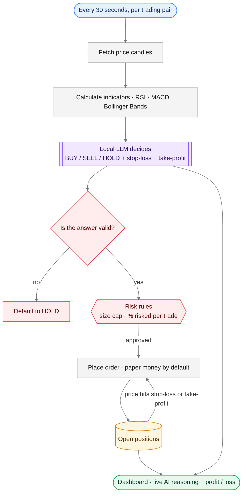
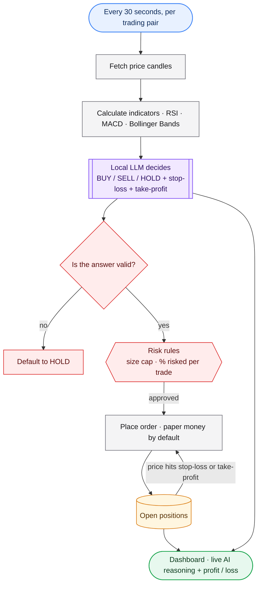

# LLM Paper Trader

> 📘 New here? Start with **[READ_THIS_OVERVIEW.md](READ_THIS_OVERVIEW.md)** for a plain-English walkthrough.

A crypto trading agent where a local model makes the call and hard-coded risk rules keep it honest — paper trading by default.

## Workflow



> **Diagram key:** blue = input · purple = AI model · grey = processing · amber = storage · red = safety / guard rail · green = output

<details><summary>Diagram source (renders on GitHub)</summary>


</details>

## What it does
- Watches each pair on a loop and computes RSI, MACD and Bollinger Bands itself.
- Hands the model a compact market picture and asks for a structured decision with entry, stop-loss and take-profit.
- Rejects malformed answers (falls back to HOLD) and applies position-size and risk caps the model can't override.
- Manages open positions and closes them automatically on stop-loss or take-profit.
- Paper trading with a simulated balance is the default; live mode needs exchange keys you add yourself.

## What this project demonstrates
- LLM as a decision-maker inside deterministic guardrails
- Async multi-pair orchestration
- Technical indicators implemented from scratch
- Exchange integration through a common trading library

## Quick start
1. Install Ollama and pull a model.
2. `bash install.sh` (Windows: `install.bat`)
3. `python main.py` — dashboard at `http://localhost:5050`. Pairs and risk settings live in `config.yaml`.

## Project layout
```
main.py                 ← orchestrator
config.yaml             ← pairs, risk, model (keys left blank)
core/llm_brain.py       ← prompt + decision parsing
core/indicators.py      ← RSI / MACD / Bollinger
core/position_manager.py← SL / TP / limits
core/exchange.py        ← exchange + paper mode
dashboard/              ← live view
```

## Notes
Experimental. Keep it in paper mode unless you understand the risks. Not financial advice.

## License
MIT — see [LICENSE](LICENSE).
